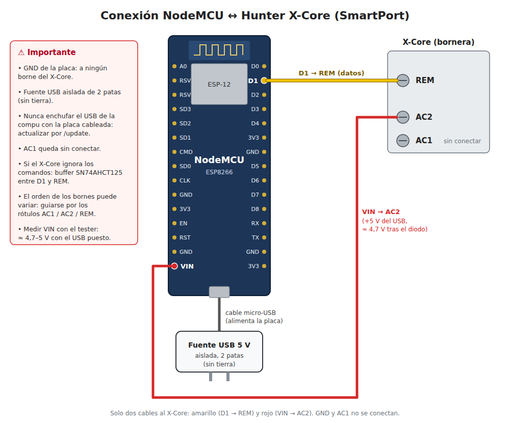

# Connection to the SmartPort

The Hunter SmartPort, which communicates with a proprietary protocol, consists of three pins:

 - AC#1 and AC#2: 24 VAC
 - REM: the data port, based on the 1-wire protocol.

The interesting part of this setup is that the REM port operates at 5 VDC with respect to the AC#2, which means that you need a floating power supply in order to align it to this pin.

My experience (and other people who also tried it), is that it will also work with the D1 Mini Pro's (or any Arduino) 3.3 VDC GPIO, so you won't need to buy a boost converter.

## 1. Using an external power supply

Power the board from an isolated USB charger plugged into its micro-USB port, and wire only two cables to the controller:

- **GPIO5 / D1 → REM** (data). The upstream default is GPIO16 / D0; this project moved it to D1 so the NodeMCU onboard LED on D0 does not stay lit.
- **VIN → AC#2**. On the NodeMCU, VIN is the USB 5 V after a diode (≈ 4.7 V), which aligns the board with the REM reference. Measure VIN with a multimeter first: some clones do not wire it to USB.
- GND and AC#1 stay unconnected.

Alternatively, cut the charger's USB cable and wire its 5 VDC (normally red) to VIN and AC#2, and its 0 V to GND only.

You can also [check a real photo of the upstream author's setup](../images/my-setup.jpeg) (a Hunter Pro-C, powered the same way through USB).

### Safety and grounding warnings

These match the findings documented in
[aprather21/hunter-x2-esphome](https://github.com/aprather21/hunter-x2-esphome)
(Hunter X2, same REM/SmartPort interface):

- **Never connect the board's GND to any controller terminal.** Only the
  charger's 0 V goes to GND. The controller runs its processor on a negative
  supply: AC#2 is the processor's +3.3 V rail and its ground sits 3.3 V below
  it, so the REM line is referenced to AC#2. Tying GND to AC#1/AC#2 inverts
  the signal and the controller silently ignores every command.
- **Use an isolated 2-prong charger** (no earth pin). The whole 24 VAC circuit
  floats with respect to earth and must stay that way.
- **Never plug the board into a computer's USB while it is wired to the
  controller**: that bonds the controller's supply to earth through the
  computer. Update over WiFi (`/update`), or disconnect the controller wires
  and flash at the desk.
- **Signal margin:** driving REM straight from a 3.3 V GPIO (as here and in
  upstream hunter-wifi) works in practice, but the logic "high" has little
  margin. If the controller ignores commands, add a 5 V buffer such as an
  SN74AHCT125 (or 74AHCT1G125) between the GPIO and REM, as aprather21 does.

## 2. Using the 24 VAC from the SmartPort

This should be the best option, as you wouldn't need an external power source.

However, I bought a 24 VAC to 5 VDC converter but, after many tries, I couldn't work out the connections.

Note! Check out [@gashtaan's comment](https://github.com/ecodina/hunter-wifi/issues/12#issuecomment-1082636694).
